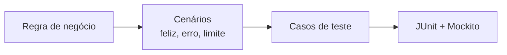
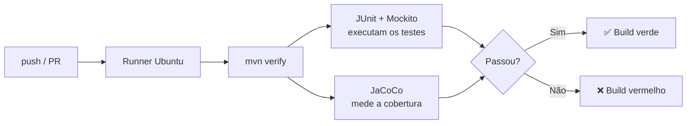

# JUnit, Mockito e JaCoCo

## Testes automatizados em Java

**T01 · Unitário / Integração**

Validação de regras de negócio em um microsserviço Java

Renata · Alessandra · Heitor · Aroldo

15/10

---

# Motivação: e se a regra quebrar sem ninguém perceber?

Um sistema de transferência PIX tem a regra: **o saldo deve cobrir o valor**.

Alguém altera o código e troca `>=` por `>` sem querer.

<div class="grid grid-cols-2 gap-8 pt-4">
<div>

### Sem teste automático

<v-clicks>

- Ninguém percebe na hora
- O erro chega ao **cliente**: quem tem saldo exato não consegue transferir
- Corrigir em produção custa caro
- Medo de mexer no código

</v-clicks>

</div>
<div>

### Com teste automático

<v-clicks>

- O teste **falha em segundos**
- O erro é pego antes do commit
- A regra fica documentada em código
- Mudar o sistema com segurança

</v-clicks>

</div>
</div>

<!--
Esse é o motivo de fazer testes: proteger as regras de negócio contra regressões.
O mesmo projeto PIX será usado na parte prática.
-->

---

# Pirâmide de testes

<div class="flex items-center justify-center h-full">
  
</div>

<!--
Base: muitos testes unitários (rápidos, baratos).
Meio: menos testes de integração.
Topo: poucos testes ponta a ponta (lentos, caros).
Hoje focamos na base e no meio: JUnit + Mockito (unitário) e Spring Boot Test (integração).
-->

---

# Teste unitário × teste de integração

<div class="grid grid-cols-2 gap-6">
<div>

### Unitário

Testa **uma unidade** (classe ou método), com as dependências **simuladas**.

*Exemplo PIX:* `TransferenciaService` com o repository em mock. Sem banco e sem HTTP.

</div>
<div>

### Integração

Testa **componentes juntos**: controller, service e banco.

*Exemplo PIX:* `POST /api/v1/pix/transferir` com banco H2 e conferindo o status HTTP.

</div>
</div>

<v-click>

> **Atenção:** usar Mockito não torna um teste de integração. Se há mock, ainda é unitário.

</v-click>

<!--
Os colegas mostram os dois na parte prática:
unitário (TransferenciaServiceTest) e integração (TransferenciaControllerIT).
-->

---

# De onde saem os testes?

**Da regra de negócio.** Primeiro se define o comportamento esperado, depois se escreve o teste.



<v-clicks>

- A regra diz **o que** o sistema deve fazer
- Cada regra gera **mais de um cenário**: o caminho feliz, os erros e os limites
- Cada cenário vira **um teste**

</v-clicks>

<!--
Mensagem: não se testa "o código", testa-se o comportamento que a regra exige.
Se a regra não estiver clara, o teste não tem o que comprovar.
-->

---

# Exemplo: uma regra, três testes

> **RN02:** o saldo da conta de origem deve ser maior ou igual ao valor da transferência.

| Cenário | Entrada | Resultado esperado |
|---|---|---|
| Caminho feliz | saldo R$ 100, transfere R$ 40 | Transferência concluída |
| Caso de erro | saldo R$ 30, transfere R$ 50 | `SaldoInsuficienteException` |
| Limite | saldo R$ 50, transfere R$ 50 | Transferência concluída |

<v-click>

O cenário de **limite** é o que mais pega erro (`>` no lugar de `>=`), o mesmo erro da motivação.

</v-click>

<!--
Fechamos o ciclo: o teste de limite teria pego o bug do começo.
Os colegas vão escrever esses testes ao vivo na parte prática.
-->

---

# Três ferramentas, três perguntas

| Ferramenta | Responde | Faz o quê |
|---|---|---|
| **JUnit 5** | *O teste passou?* | Organiza, executa e verifica os testes |
| **Mockito** | *Como a classe usou suas dependências?* | Cria dependências simuladas (mocks) |
| **JaCoCo** | *Que partes do código foram executadas?* | Mede a cobertura |

<br>

<v-click>

Elas **se complementam**, mas não substituem uma à outra.

</v-click>

---

# JUnit 5

**Framework** para escrever e executar testes em Java.

```java
@Test
void deveSomarDoisNumeros() {
    int resultado = 2 + 3;

    assertEquals(5, resultado);
}
```

<v-clicks>

- `@Test` marca o método de teste
- `assertEquals`, `assertTrue`, `assertThrows` comparam esperado × obtido
- O teste **falha** quando o comportamento está errado
- Roda pelo Maven (`./mvnw test`) e pelo IntelliJ

</v-clicks>

---

# Padrão AAA: Arrange, Act, Assert

<div class="grid grid-cols-2 gap-6">
<div>

**Método testado**

```java
boolean temSaldoSuficiente(
    double saldo, double valor) {
  return saldo >= valor;
}
```

<v-clicks>

- **Arrange:** define os dados do cenário
- **Act:** chama **uma** ação
- **Assert:** confere o resultado esperado

</v-clicks>

</div>
<div>

**O teste**

```java
@Test
void deveAceitarQuandoSaldoCobre() {
  // Arrange
  double saldo = 100;
  double valor = 40;

  // Act
  boolean resultado =
      temSaldoSuficiente(saldo, valor);

  // Assert
  assertTrue(resultado);
}
```

</div>
</div>

<!--
Exemplo propositalmente simples, sem banco e sem mock, só para mostrar a estrutura.
O nome do teste descreve o cenário e o resultado esperado.
Um teste, uma ação, uma verificação principal.
Na parte prática os colegas aplicam o mesmo padrão ao TransferenciaService.
-->

---

# Mockito

**Biblioteca** que simula as dependências de uma classe.

```java
ContaRepository repo = mock(ContaRepository.class);

when(repo.findById(1L)).thenReturn(Optional.of(conta));

service.transferir(...);

verify(repo).save(conta);
```

<v-clicks>

- `when(...).thenReturn(...)`: define a resposta do mock
- `verify(...)`: confere se a chamada aconteceu
- Testa a **regra de negócio** sem banco e sem HTTP
- Mock não é, por si só, teste de integração

</v-clicks>

---

# JaCoCo: cobertura de código

JaCoCo instrumenta ou analisa o bytecode Java para calcular métricas como:

- **Cobertura de instruções:** instruções executadas
- **Cobertura de branches:** ramificações de decisões executadas, quando aplicável
- **Linhas e métodos:** métricas complementares

A cobertura ajuda a encontrar áreas pouco exercitadas.

<v-click>

> **Cobertura alta não garante testes bons.** Um teste pode executar uma linha sem verificar o resultado correto.

</v-click>

---

# JaCoCo com Maven

Adicione o plugin ao `pom.xml`:

```xml
<build>
  <plugins>
    <plugin>
      <groupId>org.jacoco</groupId>
      <artifactId>jacoco-maven-plugin</artifactId>
      <version>0.8.13</version>
      <executions>
        <execution>
          <goals>
            <goal>prepare-agent</goal>
          </goals>
        </execution>
        <execution>
          <id>report</id>
          <phase>test</phase>
          <goals>
            <goal>report</goal>
          </goals>
        </execution>
      </executions>
    </plugin>
  </plugins>
</build>
```

Execute `./mvnw test`. O relatório HTML fica em:

```text
target/site/jacoco/index.html
```

<!--
Verifique a versão do plugin compatível com a versão de Java do projeto.
A configuração é um exemplo de referência; ajuste conforme o pom.xml existente.
-->

---

# JUnit × pytest

<div class="grid grid-cols-2 gap-4">
<div>

**JUnit 5 (Java)**

```java
@Test
void deveLancarErro() {
    assertEquals(5, soma(2, 3));
    assertThrows(
        IllegalArgumentException.class,
        () -> dividir(1, 0));
}
```

</div>
<div>

**pytest (Python)**

```python
def test_deve_lancar_erro():
    assert soma(2, 3) == 5
    with pytest.raises(ValueError):
        dividir(1, 0)
```

</div>
</div>

| | JUnit 5 | pytest |
|---|---|---|
| Linguagem | Java (tipagem estática) | Python (tipagem dinâmica) |
| Estrutura | Classes e anotações (`@Test`) | Funções `test_*` |
| Asserções | Métodos (`assertEquals`) | `assert` simples |
| Preparação | `@BeforeEach` | *fixtures* |
| Vários casos | `@ParameterizedTest` | `@pytest.mark.parametrize` |
| Mocks | Mockito | `unittest.mock` / pytest-mock |
| Cobertura | JaCoCo | coverage.py / pytest-cov |

<!--
Ideia central: o objetivo é o mesmo (testar), muda o estilo.
JUnit é mais verboso e explícito; pytest é mais enxuto.
-->

<style>
table td, table th { padding: 3px 10px; }
table { font-size: 0.85em; }
</style>

---

# Integração Contínua (CI)

**E se alguém esquecer de rodar os testes?**

<div class="grid grid-cols-2 gap-8 pt-4">
<div>

### Sem CI

<v-clicks>

- "Na minha máquina funciona"
- Alguém esquece de rodar os testes
- O bug aparece dias depois
- A cobertura cai sem ninguém notar

</v-clicks>

</div>
<div>

### Com CI

<v-clicks>

- Roda numa máquina **limpa**
- Os testes rodam **sempre**, a cada push e PR
- O bug aparece em **minutos**, no commit exato
- A cobertura mínima vira **regra**

</v-clicks>

</div>
</div>

<!--
Até aqui: JUnit escreve, Mockito isola, JaCoCo mede. Mas só funciona se alguém lembrar de rodar.
CI = a cada mudança, um servidor faz build + testes automaticamente.
Usaremos o GitHub Actions, que já vem integrado ao GitHub.
-->

---

# GitHub Actions: um único arquivo

`.github/workflows/ci.yml`

```yaml {all|3-7|10|13-14|16-21|23-24}
name: CI - Testes Java

on:
  push:
    branches: [ main ]
  pull_request:
    branches: [ main ]

jobs:
  testes:
    runs-on: ubuntu-latest
    steps:
      - name: Baixar o código
        uses: actions/checkout@v5

      - name: Configurar JDK 21
        uses: actions/setup-java@v5
        with:
          distribution: temurin
          java-version: '21'
          cache: maven

      - name: Testes (JUnit + Mockito) e cobertura (JaCoCo)
        run: ./mvnw -B clean verify
```

<!--
Quando: todo push e PR na main.
Onde: uma VM Ubuntu nova a cada execução.
O quê: 3 passos — baixar o código, instalar o Java (com cache do Maven), rodar mvn verify.
O YAML é simples porque a inteligência está no pom.xml.
-->

---

# O que acontece a cada push



<v-clicks>

- **JUnit:** um `assert` falhou → build vermelho
- **Mockito:** sem banco nem serviços reais → testes **rápidos** e **estáveis** no CI
- **JaCoCo:** cobertura abaixo do mínimo → build vermelho

</v-clicks>

<!--
O CI só orquestra; quem faz o trabalho são as ferramentas configuradas no pom.xml.
Sem mocks, o pipeline precisaria subir banco, filas, outros serviços: lento e instável.
-->

---

# JaCoCo como "porteiro"

Adicione a meta `check` ao plugin do JaCoCo no `pom.xml`:

```xml
<execution>
  <id>check</id>
  <phase>verify</phase>
  <goals><goal>check</goal></goals>
  <configuration>
    <rules>
      <rule>
        <element>BUNDLE</element>
        <limits>
          <limit>
            <counter>LINE</counter>
            <value>COVEREDRATIO</value>
            <minimum>0.80</minimum>
          </limit>
        </limits>
      </rule>
    </rules>
  </configuration>
</execution>
```

<v-click>

> Por isso `verify` e não `test`: o `check` roda na fase **verify**, depois dos testes.

</v-click>

<!--
mvn test para antes do verify, então o limite de cobertura não é aplicado.
Se mvn verify passa na sua máquina, passa no CI: é exatamente o mesmo comando.
-->

---

# Bloqueando o merge

**Settings → Branches →** regra para `main` → *Require status checks to pass*

```text
Teste falhou             →  ❌ merge bloqueado
Cobertura abaixo de 80%  →  ❌ merge bloqueado
Tudo passou              →  ✅ merge liberado
```

<v-click>

<br>

> **JUnit + Mockito + JaCoCo + CI** = nenhum código sem teste entra na `main`.

</v-click>

<!--
Por padrão o CI só avisa. Com a proteção de branch, ele impede.
Demo: abrir PR com teste quebrado (expected 90 but was 100) e PR com código sem teste (cobertura 72%).
-->

---
layout: center
class: text-center
---

# Resumo

Testamos para **proteger as regras de negócio**

<br>

**JUnit** executa e verifica · **Mockito** isola · **JaCoCo** mede · **CI** automatiza

<br>

**Unitário:** valida uma unidade isolada · **Integração:** valida componentes em conjunto
